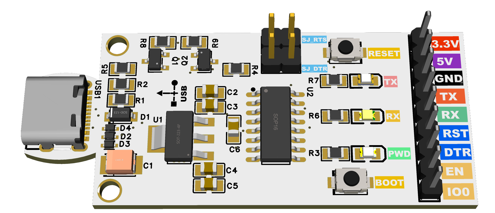
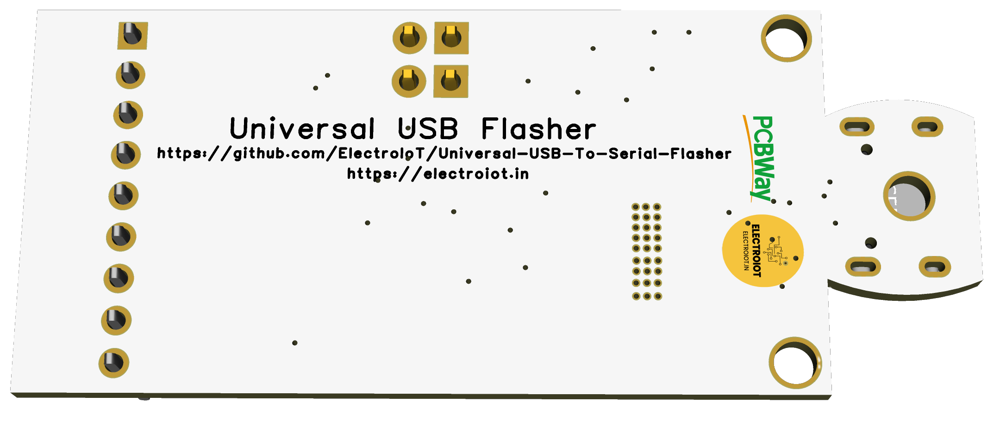
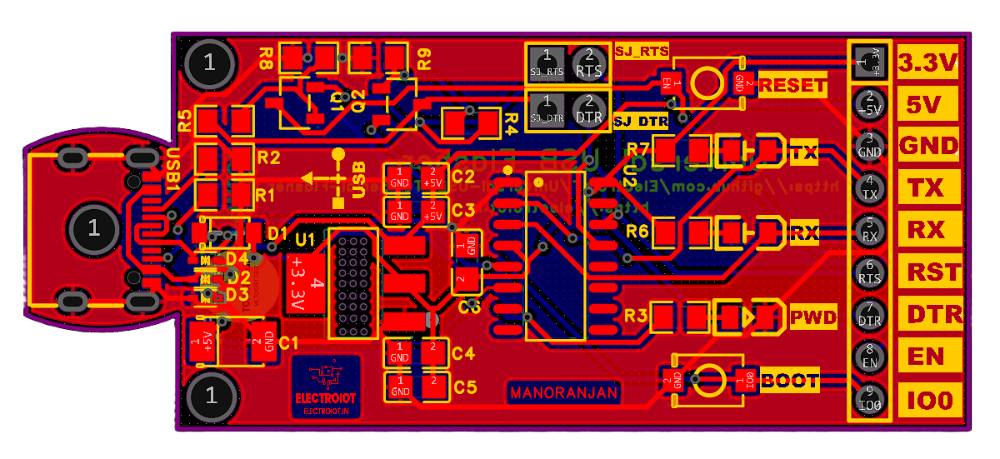
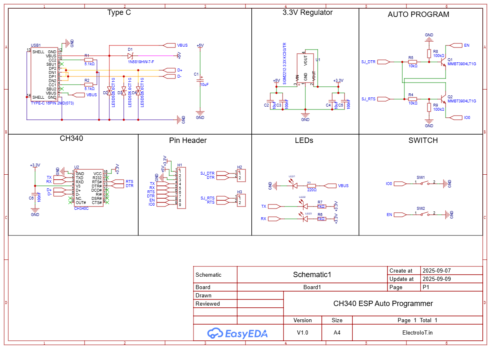

# 🚀 ESP & Arduino Universal USB Flasher (CH340C Based)

  
*Final 3D PCB Render with Color-Coded Silkscreen*
  
*Final 3D PCB Render with Color-Coded Silkscreen*

> **V2 in progress:** CH343G (3.3V/5V logic), ESP-01 socket, UPDI mode, Arduino RST pin, polyfuse, and a fix for the V1 IO0 transistor wiring. Full V2 project (README with animated diagrams, BOM, EasyEDA checklists): **[ElectroIoT/Universal-USB-Flasher-V2](https://github.com/ElectroIoT/Universal-USB-Flasher-V2)**. The original plan is in [V2/README.md](V2/README.md).

---

## 📖 Overview
This project is a **universal USB-to-Serial flasher board** based on the **CH340C USB-UART bridge**.  
It is designed for **ESP8266, ESP32, ESP01, Arduino, and other microcontrollers** with UART bootloading.  

Unlike cheap USB-to-TTL adapters, this flasher includes:  
- **Auto-programming circuit** (RTS/DTR → EN/IO0)  
- **Reset & Boot pushbuttons** for manual control  
- **Colored silkscreen pin labels** for easy connection  
- **Status LEDs** (PWR, TX, RX)  
- **USB-C connector with ESD protection**  
- **Clean PCB layout with ground pours**  

This makes it a reliable, beginner-friendly, and professional-quality programmer.

---

## ⚡ Features
- 🔌 **USB-C connector** (reversible, modern interface)  
- ⚡ **CH340C USB-UART chip** (stable drivers, Windows/Linux/macOS support)  
- 🔒 **ESD protection diodes** on USB D+/D−  
- 🔄 **Auto-reset circuit** for ESP32/ESP8266 (no need to hold BOOT manually)  
- ⏹ **Manual RESET & BOOT buttons** for recovery and testing  
- 🌈 **Color-coded silkscreen pin labels** for easy wiring:
  - 3.3V (Red), 5V (Purple), GND (Black), TX (Orange), RX (Green), RST/DTR (Blue), EN/IO0 (Yellow)  
- 💡 **LED indicators**:
  - Green = Power  
  - Orange = TX activity  
  - Yellow = RX activity  
- 🛡️ **SJ jumpers (SJ_RTS, SJ_DTR)** to enable/disable auto-programming  
- 📏 Compact PCB: **~62 × 27 mm**

---

## 🧩 Pinout
| Pin  | Function | Color |
|------|----------|-------|
| 3.3V | 3.3 V output | 🔴 Red |
| 5V   | 5 V from USB | 🟣 Purple |
| GND  | Ground | ⚫ Black |
| TX   | UART Transmit | 🟧 Orange |
| RX   | UART Receive | 🟩 Green |
| RST  | Reset / EN | 🟦 Blue |
| DTR  | Data Terminal Ready | 🟦 Blue |
| EN   | Chip Enable | 🟨 Yellow |
| IO0  | Boot Mode Select | 🟨 Yellow |

---

## 🛠️ SJ_RTS and SJ_DTR
Two solder jumpers are included:

- **SJ_RTS** → Connects RTS → EN (reset line).  
- **SJ_DTR** → Connects DTR → IO0 (boot line).  

### 🔹 Why they are useful
- Default = **closed** (auto-programming works normally).  
- If you **cut the jumper**, auto-reset for that pin is disabled.  
- This lets you take manual control via the pushbutton, useful for debugging or when using the board as a **generic USB-UART adapter**.  

👉 For ESP32/ESP8266 flashing: **leave both SJ closed**.  
👉 For Arduino or other MCUs without auto-program support: you can cut them.

---

## 📦 Bill of Materials (BOM)
Here are the key components (from your BOM):

| Qty | Reference | Value   | Part No / Notes |
|-----|-----------|---------|-----------------|
| 1   | U2        | CH340C  | USB-UART bridge |
| 1   | U1        | SGM2212-3.3 | 3.3V LDO regulator |
| 2   | Q1, Q2    | MMBT3904 | NPN for auto-program |
| 2   | R8, R9    | 100k    | Base pulldown resistors |
| 2   | R1, R2    | 10k     | Base resistors (RTS/DTR) |
| 2   | R4, R5    | 10k     | Pull-ups (EN, IO0) |
| 1   | R3        | 1k      | Power LED resistor |
| 2   | R6, R7    | 2.2k    | TX/RX LED resistors |
| 3   | LED1-3    | Green/Orange/Yellow | Power, TX, RX indicators |
| 3   | D2–D4     | LESD5D5.0 | USB ESD protection |
| 1   | D1        | 1N5819  | Reverse protection |
| 5   | C1–C5     | 10 µF   | Bulk capacitors |
| 3   | C3, C5, C6| 100 nF  | Decoupling capacitors |
| 2   | SW1, SW2  | Reset/Boot buttons | Tactile SMD |
| 1   | USB1      | USB-C connector | Receptacle |

(📑 Full detailed BOM available in Excel file)

---

## 🖼️ PCB Layout
  
*Final routed PCB layout with ground pours*

## 🖼️ PCB Schematic
  
*Final routed PCB Schematic*

---

## 🔌 How to Use
1. **Connect the board** via USB-C to your PC.  
   - Install CH340 drivers (Windows only, Linux/macOS usually auto-detect).  
2. **Connect your target microcontroller** using the 9-pin header.  
   - ESP32/ESP8266: connect 3.3V, GND, TX, RX, EN, IO0.  
   - Arduino: connect VCC, GND, TX, RX, RST.  
3. **Flashing ESP8266/ESP32**:  
   - Auto-programming works (no need to hold BOOT).  
   - Use Arduino IDE / esptool.py / PlatformIO to upload code.  
4. **Flashing Arduino/AVR**:  
   - Connect TX/RX + RST.  
   - Disable SJ jumpers if needed.  
5. **Manual boot mode**:  
   - Hold **BOOT** + press **RESET** → release RESET, then release BOOT.  
6. **LEDs**:  
   - PWR = board powered  
   - TX = blinks when sending data  
   - RX = blinks when receiving data  

---

## 📑 Why Use This Board
- 🟢 **Safer for ESP** (3.3V regulated output, correct auto-programming circuit).  
- 🟢 **Beginner-friendly** (color-coded silkscreen, clear pinout).  
- 🟢 **Robust USB-C connector** with ESD protection.  
- 🟢 **Supports multiple targets**: ESP32, ESP8266, ESP01, Arduino, STM32 (UART bootloader).  
- 🟢 **Debug-friendly**: RESET/BOOT buttons, jumpers to disable auto-reset.  

---

## 📸 Project Assets
- ✅ 3D Render (top view)  
- ✅ PCB Layout (routing + pours)  
- ✅ BOM (Excel, LCSC parts)  
- ✅ Schematics (EasyEDA / PDF)  

All files can be published on GitHub/PCBWay for sharing.  

---

## 📂 Downloads
- [📄 Schematic (PDF)](/Schematic/Schematic1_.png)  
- [📄 BOM (Excel)](/BOM/BOM_Board1_Schematic1_2025-09-09.xlsx)  
- [📄 Pick And Place (Excel)](/BOM/PickAndPlace_PCB1_2025-09-09.xlsx)
- [📄 PCB Layout (PNG)](/Image/pcb_layout.png)  
- [📄 3D Preview (PNG)](/Image/3d_Front.png)  

---

## 🌐 Author & Contact
👨‍💻 Designed by **ElectroIoT**  
🔗 Website: [https://electroiot.in](https://electroiot.in)  
▶️ YouTube: [ElectroIoT-IN](https://www.youtube.com/@ElectroIoT-IN)  
📸 Instagram: [@electroiot_in](https://www.instagram.com/electroiot_in)  
📧 Email: **electroiot.in@gmail.com**

---

✨ _Open Source Hardware for Makers – Share, Learn & Build Together!_

---
